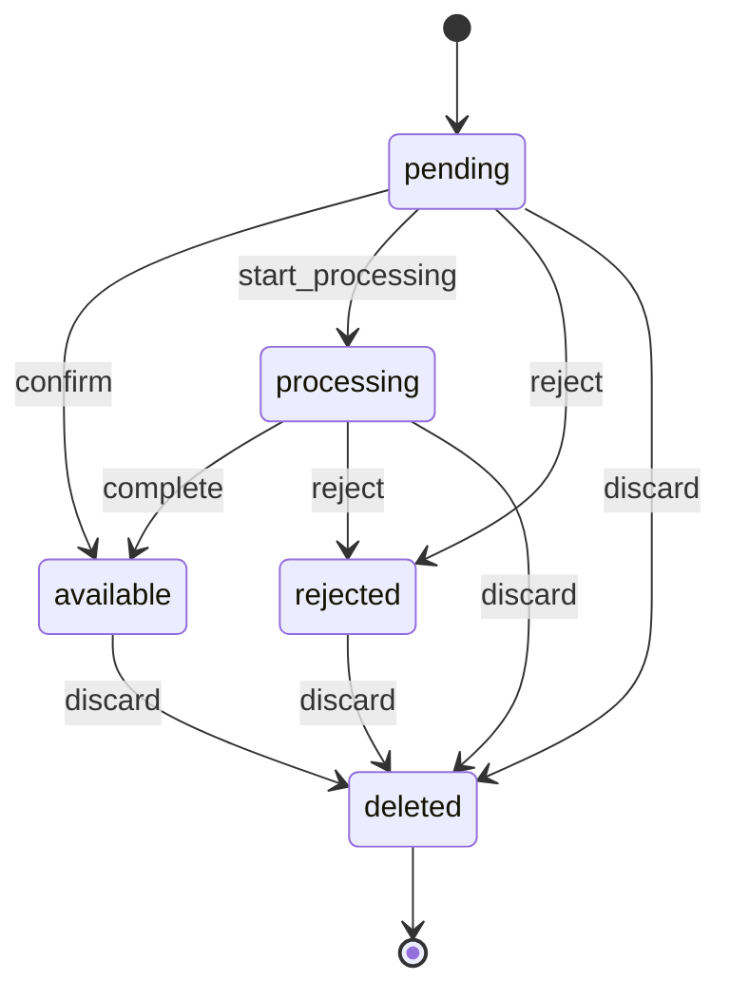
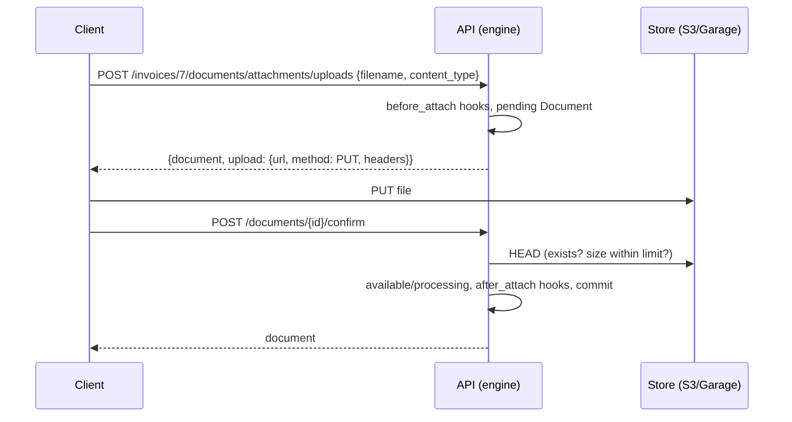

# Documents

Business resources often need files: signed contracts, receipts, scans, generated
PDFs. Resource Engine treats them as a built-in resource, `documents`, so they get
the same lifecycle, events, generated docs and AI context as any other resource.

- **Metadata** (name, type, size, sha256, owner, state) is a `Document` row in your
  database, written in the same transaction as the operation that attaches it.
- **Content** goes to a `BlobStore` (S3, Garage, MinIO, R2…; in memory for tests).
- The row is the source of truth: a blob without a committed row is garbage.

## Setup

```python
from resource_engine import ResourceManager
from resource_engine_s3 import S3BlobStore, s3_client_options

registry.register_documents()  # the built-in DocumentResource
manager = ResourceManager(registry, uow_factory, blob_store=S3BlobStore(s3_client, "my-bucket"))
```

With SQLAlchemy, add the table and the mapping next to your own:

```python
from resource_engine_sqlalchemy import documents_table, map_documents

map_documents(mapper_registry, documents_table(metadata))
```

A resource that declares slots without a blob store, or a blob store without the
documents resource, fails at bootstrap (RE-E001).

## Slots

```python
class InvoiceResource(Resource):
    documents = [
        DocumentSlot(
            "signed_pdf",
            content_types=["application/pdf"],
            max_bytes=10_000_000,
            required_for=["approve"],
            description="Customer-signed invoice",
        ),
        DocumentSlot("attachments", multiple=True, description="Supporting files"),
        DocumentSlot("scans", content_types=["image/*"], multiple=True, processing=True),
    ]
```

| Option | Meaning |
|---|---|
| `content_types` | Accepted MIME types, `*` patterns allowed (RE-E602 otherwise). |
| `max_bytes` | Enforced while streaming and on upload confirmation (RE-E603 / RE-E604). |
| `multiple` | Otherwise attaching replaces (detaches) the previous document. |
| `upload` | `api`, `presigned` or `any`. |
| `required_for` | Transitions that need an *available* document in the slot (RE-E606). |
| `processing` | New documents go through the processing pipeline first. |
| `description` | Shown in generated docs; `docs validate` warns without it (RE-D009). |

## States



Only `available` documents can be downloaded (RE-E605). Document transitions are
internal (`expose_transitions = False`): they are driven by the operations below.

## Operations and the lifecycle

`manager.documents` runs the **owner's** lifecycle with the operations `attach`
and `detach` (see [lifecycle](lifecycle.md)):

| Step | attach | detach |
|---|---|---|
| 3 | validate filename, type, declared size; `before/after_validate` | – |
| 5 | load the owner (RE-E102) | load the owner |
| 6 | `before_attach[:slot]` | `before_detach[:slot]` |
| 7 | stream to the store (**staged effect**), add the row, replace the old one | mark `deleted` |
| 8 | `after_attach[:slot]` | `after_detach[:slot]` |
| 9 | commit: the document is visible | commit |
| 10 | purge replaced blobs, `DocumentAttached` | purge the blob, `DocumentDetached` |

If anything fails after the blob was stored, the rollback compensation deletes it.
Deleting the owner discards its documents in the same transaction.

```python
doc = await manager.documents.attach(
    "invoices", 7, "signed_pdf", stream, filename="signed.pdf", content_type="application/pdf"
)
await manager.documents.detach("invoices", 7, doc.id)
meta, chunks = await manager.documents.open(doc.id)
```

Inside actions and hooks, `ctx.documents.attach(NewDocument(...))` attaches files
produced by code (e.g. a rendered PDF) in the current transaction, without running
the attach hooks (see `RenderSummary` in the invoices example).

### Presigned uploads



Pending documents expire after `upload_ttl` (15 minutes by default).

## HTTP routes (`resource-engine-fastapi`)

| Route | Purpose |
|---|---|
| `GET /{resource}/{id}/documents?slot=` | List an entity's documents |
| `POST /{resource}/{id}/documents/{slot}` | Multipart upload through the API |
| `POST /{resource}/{id}/documents/{slot}/uploads` | Presigned upload ticket |
| `POST /documents/{doc}/confirm` | Confirm a presigned upload |
| `GET /documents`, `GET /documents/{doc}` | Metadata |
| `GET /documents/{doc}/content` | Stream (or 307 to a presigned URL with `redirect_downloads=True`) |
| `DELETE /{resource}/{id}/documents/{doc}` | Detach |

Downloads send `Content-Disposition: attachment` with an RFC 6266 file name and
`X-Content-Type-Options: nosniff`. Starlette spools multipart uploads to a temporary
file above 1 MB before the engine reads them; prefer presigned uploads for large
files.

## Processing pipeline

```python
class Scanner:
    name = "antivirus"

    def accepts(self, document):
        return True

    async def process(self, document, content):
        verdict = await scan(content())
        return (
            ProcessingResult(reject="infected")
            if verdict.bad
            else ProcessingResult(metadata={"engine": verdict.engine})
        )


router = DocumentPipeline(manager.documents, [Scanner()]).register(EventRouter(ignore_unknown=True))
consumer = MessageConsumer(source, MessageProcessor(router, name="documents", inbox=uow_factory))
```

The pipeline handles `DocumentAttached` events of slots with `processing=True`.
Each processor can add metadata (stored under `metadata[<name>]`), produce derived
documents (thumbnails, extracted text) or reject the document. Raising an
exception means "try again later": the messaging layer retries and dead-letters.
Redeliveries are harmless: documents no longer `processing` are skipped.

## Reference processors

Ready-made processors for untrusted uploads:

```python
from resource_engine.documents.processors import ContentTypeCheck, TextExtraction
from resource_engine_clamav import ClamAvScanner
from resource_engine_http import TikaTextExtractor

DocumentPipeline(
    manager.documents,
    [
        ClamAvScanner("clamav", 3310),
        ContentTypeCheck(),
        TextExtraction(TikaTextExtractor(http, "http://tika:9998"), slot="texts"),
    ],
).register(router)
```

| Processor | Package | What it does |
|---|---|---|
| `ClamAvScanner` | `resource-engine-clamav` | Streams the content to `clamd` (`INSTREAM`, TCP or a Unix socket). Infected files are rejected with the signature (`virus found: ...`). If clamd is down, the scan is retried and the document stays `processing`, never available unscanned. |
| `ContentTypeCheck` | `resource-engine` | Compares the first bytes with the declared type: a "PNG" that is a PDF, or anything that is a Windows or Linux executable, is rejected. Content with no signature (text, CSV, JSON) passes. |
| `TextExtraction` | `resource-engine` | Stores the text as a derived `text/plain` document in `slot`, and `characters`, `pages` and `language` as metadata (`preview=` keeps the first characters too). |
| `BuiltinTextExtractor` | `resource-engine` | Text, CSV, JSON, XML and Word (`.docx`), no dependencies (the default extractor). |
| `TikaTextExtractor` | `resource-engine-http` | An Apache Tika server: PDF, Office, OpenDocument, e-mail, HTML, and images with `ocr=True`. |

Put the scanner first, so no other processor reads malware. Derived text
documents are not extracted again. Keep clamd's `StreamMaxLength` above the
slots' `max_bytes`. Compose runs ClamAV (`:3310`, a few minutes to download
signatures on the first start) and Tika (`:9998`) for the tests.

## Clean-up

Compensations and purges are best effort. `DocumentJanitor(manager.documents).run_once()`
(from a cron job or worker) expires stale pending uploads, purges blobs of deleted
documents and deletes orphan blobs older than `grace` (1 hour).

## Security

- With an authorizer, documents inherit the owner's visibility and need
  `<resource>:attach|detach|download:<slot>` (see [permissions](permissions.md)).
  The raw `documents` resource is sensitive: only explicit grants reach it.
- Storage keys are `<resource>/<owner id>/<document id>`; user file names are never
  used in keys and are sanitised for display.
- Content types are checked against the declared type, not sniffed. Use a
  processor (antivirus, type detection) for untrusted uploads.

## Generated documents

Documents can be rendered from templates and attached to the record, for
example a printed invoice, a delivery note or a certificate:

```python
from resource_engine.generation import DocumentGenerator
from resource_engine_http import GotenbergPdfConverter

generator = DocumentGenerator(templates, pdf=GotenbergPdfConverter(http, "http://gotenberg:3000"))


class PrintInvoice(Action):
    """Prints the invoice and keeps the PDF in the ``printed`` slot."""

    async def execute(self, ctx: OperationContext) -> None:
        await generator.attach(ctx, "printed", "invoice", format="pdf", locale="ca")
```

- **Templates:** they come from the application's `TemplateRenderer`
  ([email](email.md#templates)) under `documents/`:
  `documents/invoice.html` for HTML and PDF, and `documents/invoice.md` or
  `.txt` for text. A template gets `record` (the entity's fields), `resource`
  and the `context` you pass, in `locale`, translated like emails.
- **PDF:** the HTML template is printed by a `PdfConverter`.
  `GotenbergPdfConverter` (`resource-engine-http`) calls
  [Gotenberg](https://gotenberg.dev), headless Chromium behind an HTTP API,
  which is in the compose stack on port 3010. Keep styles and images inline
  (data URLs), so printing needs no network.
- **Attaching:** the result is attached inside the operation, like an
  upload. It is part of the change and removed if the change rolls back.
  The slot's rules apply: content types, size, and `multiple`, which
  otherwise replaces the previous copy.
- **Without attaching:** `generator.generate(template, context,
  format=...)` returns the bytes and their content type, for example to
  send by email or as a download.
- **Failures:** a missing template is RE-E010, and PDF without a converter
  is RE-E001. An unreachable Gotenberg is RE-E501, and the operation fails
  without attaching anything.
- **By email:** attach it, then name it in `EmailRequested(documents=[...])`
  ([email](email.md#attachments)).

## Printouts

A printout is a document rendered from a record when someone asks for it,
and downloaded without being stored:

```python
from resource_engine.generation import Printout


class InvoiceResource(Resource):
    printouts = {
        "invoice": Printout(formats=("pdf", "html")),
        "delivery_note": Printout(template="delivery", formats=("pdf",)),
    }


manager = ResourceManager(registry, uow, generator=generator)
```

```http
GET /invoices/7/printouts/invoice?format=pdf&locale=ca
```

- **Permissions:** the record is read as the caller, with the `get`
  permission, the row filter and the tenant. The template's `record` holds
  only the fields the caller may read.
- **Template:** `documents/<template>.<format>` (the printout's name by
  default), with `record` and `resource`. `context=lambda record, actor:
  {...}` adds values; `record` is then the dict of readable fields.
- **Formats:** the first one listed is the default. Another format is
  refused with RE-E003.
- **Setup:** resources with printouts need `ResourceManager(generator=...)`,
  or the manager refuses to start (RE-E001).
- **When to attach instead:** use `generator.attach` in an action when the
  document must be kept as it was at that moment, such as an issued invoice.
  A printout always shows the record as it is now.

