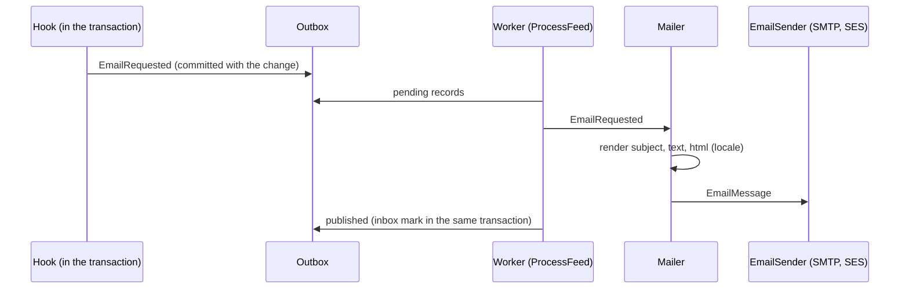

# Email and templates

Resource Engine sends transactional email from templates. A hook or an
action asks for an email inside the transaction. The request is stored with
the change, and the worker sends it once the change is committed: no email
for a change that rolled back, and no change without its email.



## Asking for an email

Record an `EmailRequested` event where the change happens:

```python
from resource_engine.email import EmailRequested


async def request_approval_email(ctx: OperationContext) -> None:
    customer = await ctx.repository("customers").get(ctx.entity.customer_id)
    if customer and customer.email:
        ctx.record_event(
            EmailRequested(
                template="invoice_approved",
                to=[customer.email],
                context={"number": ctx.entity.id, "amount": ctx.entity.amount},
                locale="ca",
            )
        )
```

- **When:** in any hook inside the transaction (`after_transition:approve`,
  `after_create`...) or in an action. Not in `after_commit`: by then the
  outbox is closed. An `after_commit` hook can call `Mailer.send` directly,
  but it then has no retries or exactly-once guarantee.
- **Fields:** `template`, `to`, `context`, `locale`, `cc`, `bcc`,
  `reply_to`, and optionally `resource` / `entity_id` (the ordering key and
  traceability).
- **Context:** it travels as JSON, so decimals and dates reach the template
  as strings. It is stored in the outbox and, with a broker, published like
  other events, so keep it to what the template needs.
- **Declaring:** `EmailRequested` is an engine event. It needs no entry in
  `Resource.events` (RE-C006) and isn't part of the module's AsyncAPI
  contract.

## Sending it

`Mailer` composes a message from a template set and hands it to an
`EmailSender`. Its `router()` handles `EmailRequested`. Run it through a
`MessageProcessor` with `manager=`, so the inbox mark commits with the
attempt and a request isn't sent twice:

```python
from resource_engine.email import Mailer
from resource_engine_jinja import JinjaTemplates
from resource_engine_smtp import SmtpEmailSender

mailer = Mailer(
    SmtpEmailSender("smtp.example.com", 587, username="api", password=SECRET),
    JinjaTemplates(package="invoices", folder="templates", default_locale="ca"),
    from_address="Factures <factures@example.com>",
    globals={"app_name": "Factures"},
)
router = ProcessRunner(manager).router().include(mailer.router())
processor = MessageProcessor(router, name="invoice-processes", manager=manager)
runner.add("processes", ProcessFeed(manager.uow_factory, processor), every=1, single=True)
```

- **One feed:** `ProcessFeed` marks the outbox records it handles as
  published, so a second feed would never see them. Combine routers with
  `EventRouter.include` and keep one feed. With a broker, consume the
  requests from it with the same router instead.
- **Retries:** an unreachable server or a temporary refusal
  (`RemoteCallFailed`, RE-E501) is retried on later runs. A permanent
  refusal (`EmailRejected`, RE-E502) and a missing or broken template
  (RE-E010, RE-E011) are settled at once and logged.
- **At least once:** if the worker stops between the provider's answer and
  the inbox mark, the message goes out again. Its `Message-ID` comes from
  the request's envelope id, so it's recognisably the same message.
- **Direct sending:** in a job or a script, `await mailer.send("report", to,
  context)` composes and sends at once. Attachments (`attachment(name,
  bytes)`) are only available this way: requests travel as JSON.

## Templates

A template set is three files under `email/`; text or html may be missing,
but not both:

```text
templates/
├── email/base.html                     layout the html bodies extend
├── email/invoice_approved.subject.txt  English (the fallback)
├── email/invoice_approved.txt
├── email/invoice_approved.html
└── ca/email/invoice_approved.subject.txt   Catalan
    ca/email/invoice_approved.txt
    ca/email/invoice_approved.html
```

- **Locales:** a request in `ca-ES` looks in `ca-ES/`, then `ca/`, then
  the renderer's default locale, then the unlocalised files. Top-level
  folders named like a locale (`ca`, `pt-BR`, `es-419`) are locales, so
  don't name template folders with two or three lower-case letters.
- **Subject:** one line. Line breaks and repeated spaces are folded.
- **Values:** the request's `context`, the mailer's `globals`, and `locale`.
  A missing value is an error (RE-E011), never an empty string.
- **Translations:** instead of a folder per locale, one template set can be
  translated by the catalogue: `{{ _("Factura %(number)s aprovada",
  number=number) }}` and `` blocks, with
  `JinjaTemplates(..., translations=...)`. The example works this way. See
  [translations](i18n.md#templates).

`TemplateRenderer` is a port. There are two renderers:

| Renderer | Package | For |
|---|---|---|
| `JinjaTemplates` | `resource-engine-jinja` | Real templates: inheritance (``), loops, filters. Sandboxed, autoescaped for `.html`/`.xml`, strict about undefined values. Templates from a folder or shipped in a package. |
| `StringTemplates` | `resource-engine` (`resource_engine.templates`) | Tests and small apps: a dict of `$name` templates, HTML-escaped in `.html`. |

The same renderers serve generated documents (an action rendering a
Markdown or HTML summary).

## Senders

| Service | Package | Class | Tested against |
|---|---|---|---|
| Any SMTP server or relay (Postfix, Microsoft 365, SES/Postmark/SendGrid SMTP) | `resource-engine-smtp` | `SmtpEmailSender` | Mailpit (compose) |
| Amazon SES (v2 API) | `resource-engine-aws[ses]` | `SesEmailSender` | AWS Emulator (refusals; it keeps identities unverified) and a recording client |
| Postmark | `resource-engine-http` | `PostmarkEmailSender(http, token=...)` | mock transport |
| SendGrid / Twilio | `resource-engine-http` | `SendGridEmailSender(http, api_key=...)` | mock transport |
| Microsoft 365 (Graph `sendMail`) | `resource-engine-http` | `GraphEmailSender(http, mailbox=...)`, with `OAuth2ClientCredentials` | mock transport |
| In memory | `resource-engine` (`resource_engine.testing`) | `RecordingEmailSender` | – |

- **SMTP:** port 465 uses implicit TLS; other ports upgrade with STARTTLS
  when offered (`starttls=True` requires it). `tls=False` is only for a
  local catcher. 5xx answers are `EmailRejected`, the rest
  `RemoteCallFailed`.
- **SES:** sends the MIME document (`Content.Raw`), so attachments, headers
  and the `Message-ID` go through as composed. The template name becomes
  an SES message tag, for a configuration set's event destinations.

## Checks

`resource-engine check` reads every hook and action (and the application
functions they call). Each `EmailRequested(template="...")` with a literal
name needs a subject and a body for its locale, or unlocalised (**RE-C007**).
Point it at the renderer:

```toml
[tool.resource-engine]
templates = "invoices.notifications:templates"
email_prefix = "email/"   # the default
```

## In the documentation

`docs generate` and `docs site` list each resource's emails (trigger,
recipients as written, locale) and add an emails page with a preview of
every template set per locale, variables shown as placeholders. See
[documentation site](docs-site.md#emails).

## Local development

Mailpit catches every message:

```bash
docker compose -f compose.emulators.yaml up -d mailpit   # SMTP :1026, UI http://127.0.0.1:8026
```

The example's worker sends through it by default (`SMTP_HOST`, `SMTP_PORT`,
`SMTP_USERNAME`, `SMTP_PASSWORD`, `SMTP_TLS` and `EMAIL_FROM` configure a
real server). Approving an invoice whose registered customer has an email
address sends `invoice_approved` in Catalan.

## Bounces and complaints

Addresses that bounce for good, complain (mark the message as spam) or
unsubscribe shouldn't get more mail: providers lower the sender's
reputation, and some suspend accounts. A suppression list keeps them out:

```python
from resource_engine.email import EmailEventHandler
from resource_engine_fastapi import mount_email_events
from resource_engine_http import parse_postmark
from resource_engine_sqlalchemy import SqlAlchemySuppressionList

suppressions = SqlAlchemySuppressionList(
    sessions, tables.suppressions
)  # engine_tables(suppressions=True)
mailer = Mailer(sender, templates, from_address=..., suppressions=suppressions)
mount_email_events(
    app, "/webhooks/postmark", parse_postmark, EmailEventHandler(suppressions), token=SECRET
)
```

- **Sending:** suppressed recipients are left out of every message. A
  message with nobody left isn't sent, and that is logged.
- **Events:** the webhook parsers turn each provider's payload into
  `EmailEvent`s (`bounce`, `complaint`, `delivery`, `unsubscribe`):
  `parse_postmark` and `parse_sendgrid` (`resource-engine-http`), and
  `parse_ses` (`resource-engine-aws`) for SNS notifications and
  configuration-set events.
- **What gets suppressed:** `EmailEventHandler` suppresses hard bounces,
  complaints and unsubscribes. Soft bounces (a full mailbox) and deliveries
  are only logged; `on_event=` acts on any of them, for example a record's
  status or a metric.
- **The endpoint:** `mount_email_events` checks a shared token (`?token=`,
  a bearer token or the Basic password) before parsing, and answers 204.
  Payloads it doesn't recognise are acknowledged, so the provider doesn't
  retry them. Confirm an SNS subscription once by opening its
  `SubscribeURL`.
- **Releasing:** `suppressions.release(address)` lets mail go to an address
  again, for example after the user fixes their mailbox.

Microsoft Graph has no event webhooks: failures come back to the mailbox as
non-delivery reports.
