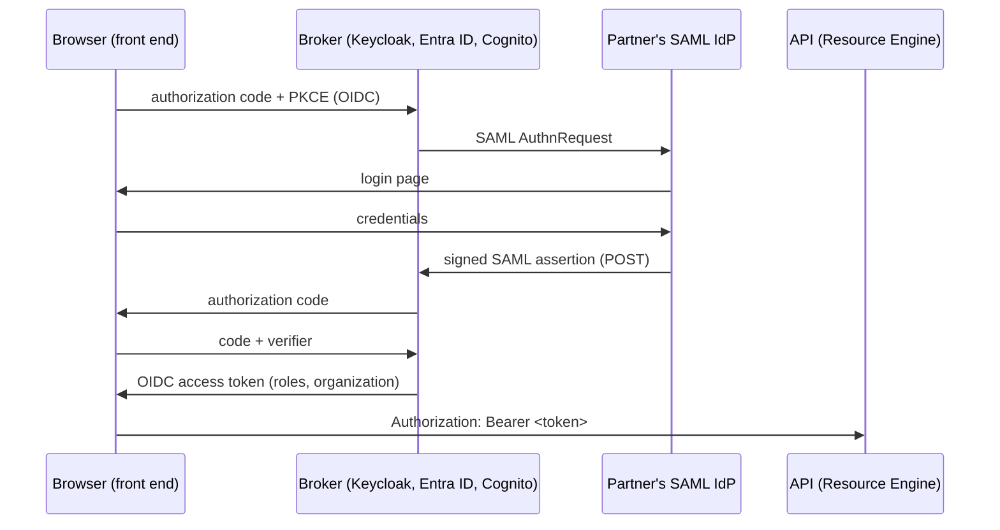

# SAML sign-in

Many companies sign their staff in with SAML 2.0: ADFS, Shibboleth, Okta or
Entra ID configured as a SAML identity provider, or an older on-premises
product. Resource Engine doesn't speak SAML to them. An identity broker does:



- **The broker** federates the SAML identity provider. It checks the
  assertion's signature, maps its attributes to users, roles and
  organizations, and issues ordinary OIDC tokens.
- **The front end** runs the usual authorization code flow with PKCE. It
  can send users straight to the partner (Keycloak's `kc_idp_hint`) or let
  them pick on the broker's login page.
- **The API** verifies the broker's JWTs with the same preset as for every
  other user (`keycloak`, `entra_id`, `cognito`). Permissions, tenancy and
  the audit trail work unchanged: a SAML user is a `Principal` like any
  other.

So there is no SAML code in the API, and adding a partner is broker
configuration, not a release.

## Brokers

| Broker | Where SAML IdPs go | Roles and tenant |
|---|---|---|
| Keycloak | Identity providers → SAML v2.0 (import the IdP's metadata) | Mappers "SAML Attribute to Role", "Attribute Importer"; link the IdP to an organization |
| Entra ID | Enterprise applications for staff; External ID → SAML/WS-Fed IdP federation for guests | App roles assigned to users or groups; `tid` is the tenant |
| Cognito | User pool → Sign-in experience → Federated identity providers → SAML | Attribute mapping to user pool attributes; groups through a pre-token-generation Lambda |
| Okta, Auth0 | Identity providers → SAML 2.0 (Okta) / Enterprise connections → SAML (Auth0) | Group or role claims in the access token |

The example realm uses Keycloak.

## The example: a partner company over SAML

The local stack has a second realm, `partner`
(`docker/keycloak/partner-realm.json`), which plays Initech's own SAML
identity provider. The `invoices` realm federates it as `partner-saml`:

- **Trust:** the partner signs responses and assertions with a fixed
  development key. The broker has its certificate (`signingCertificate`) and
  refuses unsigned or altered assertions. The tests change a role in the XML
  and check that the sign-in fails with `invalid_signature`.
- **Users:** the NameID is the partner's username. `sara` (approver) and
  `tom` (accountant) sign in with password `dev` at the partner. The broker
  creates them in `invoices` on their first sign-in, with email and name
  from the assertion (`trustEmail`, so no profile page).
- **Roles:** the assertion's `Role` attribute maps to the realm roles
  `approver` and `accountant` ("SAML Attribute to Role" mappers). Sync mode
  `FORCE` updates them at every sign-in, so a role the partner removes is
  gone from the next token.
- **Tenant:** the identity provider is linked to the Initech organization,
  so federated users become its members. Their tokens carry
  `organization: ["initech"]`, and the app confines them to Initech's
  records like any ACME or Globex user.

Try it in a browser with any OIDC client, or run the tests:

```bash
docker compose -f compose.emulators.yaml up -d keycloak
uv run pytest examples/invoices/tests/test_invoices_saml.py
```

`test_invoices_saml.py` drives the whole browser flow with httpx: the
authorization request with `kc_idp_hint=partner-saml`, the SAML request
form, the partner's login form, the SAML response form, then the code
exchange. Platform admin `root` creates an Initech invoice, `tom` reads it,
`sara` rejects it, and an ACME user doesn't see it.

The partner realm's key, the demo passwords and the development client are
for local use only. In a real setup, import the partner's metadata (its
certificate rotates with it), keep signature validation on, and prefer
encrypted assertions when the partner supports them.

## Without a broker

A service provider inside the app is only worth it for a server-rendered
app that can't use a broker. Use a maintained library, such as
`python3-saml` (OneLogin) or `pysaml2`, in the web layer. After it validates
the assertion, map it to a `Principal` and pass that to the manager as
`actor`, the way `bearer_actor` does for tokens. Then keep the session in a
server-side cookie. Resource Engine ships no SAML adapter: a broker covers
APIs, SPAs, mobile apps and MCP clients alike, and keeps XML signature
handling out of every service.
