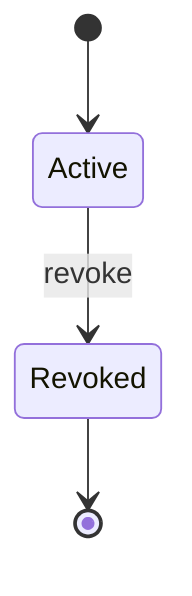

# authz_api_keys

`resource_engine.authz.apikeys.ApiKeyResource` — entitat `ApiKey`

API keys for machine clients that cannot use OAuth.

## Business area

Permissions

## Operacions

| Operació | Tipus | Endpoint | Entrada | Sortida | Descripció |
|---|---|---|---|---|---|
| `list` | crud | `GET /authz_api_keys` |  | ApiKeyRead | Lists the API keys (never their secrets). |
| `get` | crud | `GET /authz_api_keys/{id}` |  | ApiKeyRead | Returns an API key (never its secret). |
| `create` | crud | `POST /authz_api_keys` | ApiKeyCreate | ApiKeyRead | Creates an API key; the response carries the full key, once. |
| `update` | crud | `PATCH /authz_api_keys/{id}` | ApiKeyUpdate | ApiKeyRead | Renames a key or changes its expiry. |
| `revoke` | transition | `POST /authz_api_keys/{id}/transitions/revoke` |  | ApiKeyRead | Withdraw the key at once. |

Filtres: `status`, `tenant`, `created_by` · Ordenació: `name`, `created_at`, `last_used_at`, `expires_at`

Auditoria: s'auditen els canvis i els intents denegats.

## Màquina d'estats

`resource_engine.authz.apikeys.ApiKeyStates` — camp `status`

Lifecycle of an API key.

| Estat | Nom | Descripció |
|---|---|---|
| `active` (inicial) | Active | The key authenticates requests (until it expires). |
| `revoked` (final) | Revoked | The key no longer authenticates. Final. |

| Transició | Origen | Destí | Descripció |
|---|---|---|---|
| `revoke` | `active` | `revoked` | Withdraw the key at once. |

## Hooks del cicle de vida

| Punt | Hook | Efectes externs | Descripció |
|---|---|---|---|
| `before_create` | `_check_new_key` | no | The roles exist and grant nothing the creator lacks; the tenant is the |

## Schemas

### ApiKeyCreate (create)

| Camp | Tipus | Obligatori | Descripció |
|---|---|---|---|
| `name` | `str` | sí | What the key is for |
| `roles` | `list[str]` | sí | Roles the key acts with (at most the creator's) |
| `expires_at` | `datetime \| None` | no | When it stops working |
| `tenant` | `str \| None` | no | Tenant it acts in (default: the creator's) |

### ApiKeyUpdate (update)

| Camp | Tipus | Obligatori | Descripció |
|---|---|---|---|
| `name` | `str \| None` | no | — |
| `expires_at` | `datetime \| None` | no | — |

### ApiKeyRead (read)

| Camp | Tipus | Obligatori | Descripció |
|---|---|---|---|
| `id` | `str` | sí | Key id: the key starts with rek_<id>_ |
| `name` | `str` | sí | — |
| `roles` | `list[str]` | sí | — |
| `tenant` | `str \| None` | no | — |
| `status` | `str` | sí | active or revoked |
| `expires_at` | `datetime \| None` | no | — |
| `last_used_at` | `datetime \| None` | no | Last request (to a minute) |
| `created_at` | `datetime \| None` | no | — |
| `created_by` | `str \| None` | no | — |
| `key` | `str \| None` | no | The full key, only in the create response: store it now, it is not shown again |
