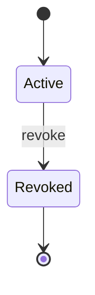
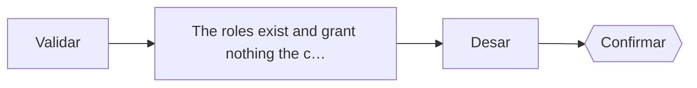

# authz_api_keys

API keys for machine clients that cannot use OAuth.

## Àmbit de negoci

Permissions

## Operacions

| Operació | Tipus | Descripció |
|---|---|---|
| `list` | crud | Lists the API keys (never their secrets). |
| `get` | crud | Returns an API key (never its secret). |
| `create` | crud | Creates an API key; the response carries the full key, once. |
| `update` | crud | Renames a key or changes its expiry. |
| `revoke` | transition | Withdraw the key at once. |

Auditoria: s'auditen els canvis i els intents denegats.

## Màquina d'estats

Lifecycle of an API key.

| Estat | Nom | Descripció |
|---|---|---|
| `active` (inicial) | Active | The key authenticates requests (until it expires). |
| `revoked` (final) | Revoked | The key no longer authenticates. Final. |

| Transició | Origen | Destí | Descripció |
|---|---|---|---|
| `revoke` | `active` | `revoked` | Withdraw the key at once. |

## Què passa en cada operació

Els passos **abans de confirmar** són dins la transacció: si un falla, el canvi es rebutja i no es desa res. Els passos **després de confirmar** s'executen amb el canvi ja desat: un error queda registrat, però no el desfà.

### Crear (`create`)

1. Es valida l'entrada.
2. Abans de desar: The roles exist and grant nothing the creator lacks; the tenant is the
3. Es desa el registre nou.
4. Es confirma el canvi, amb l'auditoria i els esdeveniments.

