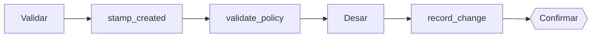
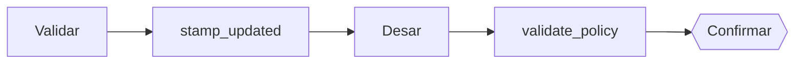
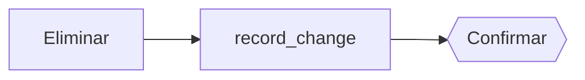

# authz_policies

`resource_engine.authz.resources.PolicyResource` — entitat `Policy`

Access policies (ABAC), managed from the front end.

A policy allows or denies actions to subjects (roles, groups, users or everyone)
when its condition holds. System roles are fixed in code and cannot be
targeted or restricted here.

## Àmbit de negoci

Permissions

## Operacions

| Operació | Tipus | Endpoint | Entrada | Sortida | Descripció |
|---|---|---|---|---|---|
| `list` | crud | `GET /authz_policies` |  | PolicyRead | Lists the access policies. |
| `get` | crud | `GET /authz_policies/{id}` |  | PolicyRead | Returns an access policy. |
| `create` | crud | `POST /authz_policies` | PolicyCreate | PolicyRead | Creates an access policy (validated against the catalogue). |
| `update` | crud | `PATCH /authz_policies/{id}` | PolicyUpdate | PolicyRead | Changes an access policy. |
| `delete` | crud | `DELETE /authz_policies/{id}` |  |  | Deletes an access policy. |

Filtres: `effect`, `enabled`, `name` · Ordenació: `name`, `created_at`, `updated_at`

Auditoria: s'auditen els canvis i els intents denegats.

## Esdeveniments de domini

### `PolicyChanged`

`resource_engine.authz.resources.PolicyChanged`

Policies or role assignments changed: caches must be refreshed.

| Camp | Tipus | Obligatori |
|---|---|---|
| `resource` | `str` | sí |
| `entity_id` | `Any` | sí |

## Què passa en cada operació

Els passos **abans de confirmar** són dins la transacció: si un falla, el canvi es rebutja i no es desa res. Els passos **després de confirmar** s'executen amb el canvi ja desat: un error queda registrat, però no el desfà.

### Crear (`create`)

1. Es valida l'entrada (`PolicyCreate`).
2. Abans de desar: `stamp_created` — Records who created the policy and when.
3. Abans de desar: `validate_policy` — Checks actions, subjects and the condition against the catalogue, and that
4. Es desa el registre nou.
5. Abans de confirmar: `record_change` — Emits ``PolicyChanged`` so every instance refreshes its permission caches.
6. Es confirma el canvi, amb l'auditoria i els esdeveniments.

### Modificar (`update`)

1. Es valida l'entrada (`PolicyUpdate`).
2. Abans de desar: `stamp_updated` — Records who changed the policy last and when.
3. Es desen els canvis.
4. Abans de confirmar: `validate_policy` — Checks actions, subjects and the condition against the catalogue, and that
5. Es confirma el canvi, amb l'auditoria i els esdeveniments.

### Eliminar (`delete`)

1. S'elimina el registre.
2. Abans de confirmar: `record_change` — Emits ``PolicyChanged`` so every instance refreshes its permission caches.
3. Es confirma el canvi, amb l'auditoria i els esdeveniments.

Després de qualsevol canvi confirmat d'aquest recurs:

- `refresh_caches` — Refreshes this instance's policy and role caches after the commit.

| Punt | Hook | Efectes externs | Descripció |
|---|---|---|---|
| `before_create` | `stamp_created` | no | Records who created the policy and when. |
| `before_create` | `validate_policy` | no | Checks actions, subjects and the condition against the catalogue, and that |
| `before_update` | `stamp_updated` | no | Records who changed the policy last and when. |
| `after_update` | `validate_policy` | no | Checks actions, subjects and the condition against the catalogue, and that |
| `after_create` | `record_change` | no | Emits ``PolicyChanged`` so every instance refreshes its permission caches. |
| `after_delete` | `record_change` | no | Emits ``PolicyChanged`` so every instance refreshes its permission caches. |
| `after_commit` | `refresh_caches` | no | Refreshes this instance's policy and role caches after the commit. |

## Esquemes

### PolicyCreate (create)

| Camp | Tipus | Obligatori | Descripció |
|---|---|---|---|
| `name` | `str` | sí | Short name |
| `description` | `str \| None` | no | What it allows or denies |
| `effect` | `Literal['allow', 'deny']` | sí | allow or deny |
| `subjects` | `Subjects` | sí | Who it applies to |
| `actions` | `list[str]` | sí | Action patterns, e.g. invoices:* |
| `condition` | `Any` | no | Condition (JSON), see GET /authz/catalog |
| `enabled` | `bool` | no | Disabled policies are ignored |

### PolicyUpdate (update)

| Camp | Tipus | Obligatori | Descripció |
|---|---|---|---|
| `name` | `str \| None` | no | — |
| `description` | `str \| None` | no | — |
| `effect` | `Literal['allow', 'deny'] \| None` | no | — |
| `subjects` | `Subjects \| None` | no | — |
| `actions` | `list[str] \| None` | no | — |
| `condition` | `Any` | no | — |
| `enabled` | `bool \| None` | no | — |

### PolicyRead (read)

| Camp | Tipus | Obligatori | Descripció |
|---|---|---|---|
| `id` | `str` | sí | Policy id |
| `name` | `str` | sí | Short name |
| `description` | `str \| None` | no | What it allows or denies |
| `effect` | `str` | sí | allow or deny |
| `subjects` | `dict[str, Any]` | sí | Who it applies to |
| `actions` | `list[str]` | sí | Action patterns |
| `condition` | `Any` | no | Condition (JSON) |
| `enabled` | `bool` | sí | Whether it is evaluated |
| `created_at` | `datetime \| None` | no | Creation time |
| `created_by` | `str \| None` | no | Who created it |
| `updated_at` | `datetime \| None` | no | Last change |
| `updated_by` | `str \| None` | no | Who changed it last |
