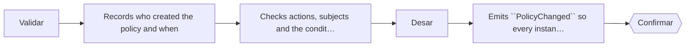
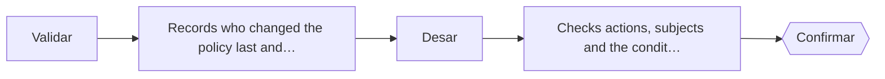
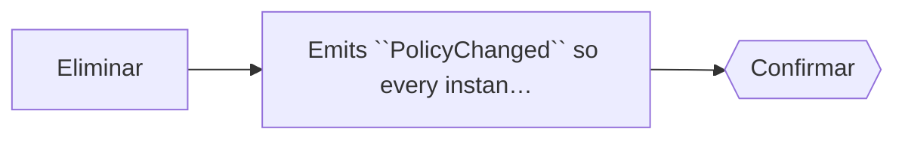

# authz_policies

Access policies (ABAC), managed from the front end.

A policy allows or denies actions to subjects (roles, groups, users or everyone)
when its condition holds. System roles are fixed in code and cannot be
targeted or restricted here.

## Àmbit de negoci

Permissions

## Operacions

| Operació | Tipus | Descripció |
|---|---|---|
| `list` | crud | Lists the access policies. |
| `get` | crud | Returns an access policy. |
| `create` | crud | Creates an access policy (validated against the catalogue). |
| `update` | crud | Changes an access policy. |
| `delete` | crud | Deletes an access policy. |

Auditoria: s'auditen els canvis i els intents denegats.

## Esdeveniments de domini

### `PolicyChanged`

Policies or role assignments changed: caches must be refreshed.

| Camp | Tipus | Obligatori |
|---|---|---|
| `resource` | `str` | sí |
| `entity_id` | `Any` | sí |

## Què passa en cada operació

Els passos **abans de confirmar** són dins la transacció: si un falla, el canvi es rebutja i no es desa res. Els passos **després de confirmar** s'executen amb el canvi ja desat: un error queda registrat, però no el desfà.

### Crear (`create`)

1. Es valida l'entrada.
2. Abans de desar: Records who created the policy and when.
3. Abans de desar: Checks actions, subjects and the condition against the catalogue, and that
4. Es desa el registre nou.
5. Abans de confirmar: Emits ``PolicyChanged`` so every instance refreshes its permission caches.
6. Es confirma el canvi, amb l'auditoria i els esdeveniments.

### Modificar (`update`)

1. Es valida l'entrada.
2. Abans de desar: Records who changed the policy last and when.
3. Es desen els canvis.
4. Abans de confirmar: Checks actions, subjects and the condition against the catalogue, and that
5. Es confirma el canvi, amb l'auditoria i els esdeveniments.

### Eliminar (`delete`)

1. S'elimina el registre.
2. Abans de confirmar: Emits ``PolicyChanged`` so every instance refreshes its permission caches.
3. Es confirma el canvi, amb l'auditoria i els esdeveniments.

Després de qualsevol canvi confirmat d'aquest recurs:

- Refreshes this instance's policy and role caches after the commit.
