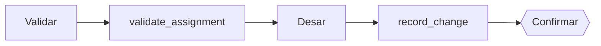
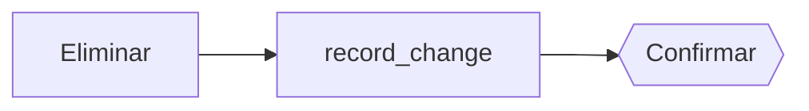

# authz_role_assignments

`resource_engine.authz.resources.RoleAssignmentResource` — entitat `RoleAssignment`

Roles given to principals or groups from the front end (used by

``StoredRoleSource``).

## Àmbit de negoci

Permissions

## Operacions

| Operació | Tipus | Endpoint | Entrada | Sortida | Descripció |
|---|---|---|---|---|---|
| `list` | crud | `GET /authz_role_assignments` |  | AssignmentRead | Lists role assignments, filterable by role, principal or group. |
| `get` | crud | `GET /authz_role_assignments/{id}` |  | AssignmentRead | Returns a role assignment. |
| `create` | crud | `POST /authz_role_assignments` | AssignmentCreate | AssignmentRead | Gives a role to a principal or a group. |
| `delete` | crud | `DELETE /authz_role_assignments/{id}` |  |  | Removes a role assignment. |

Filtres: `role`, `principal`, `group` · Ordenació: —

Auditoria: s'auditen els canvis i els intents denegats.

## Esdeveniments de domini

### `PolicyChanged`

`resource_engine.authz.resources.PolicyChanged`

Policies or role assignments changed: caches must be refreshed.

| Camp | Tipus | Obligatori |
|---|---|---|
| `resource` | `str` | sí |
| `entity_id` | `Any` | sí |

## Què passa en cada operació

Els passos **abans de confirmar** són dins la transacció: si un falla, el canvi es rebutja i no es desa res. Els passos **després de confirmar** s'executen amb el canvi ja desat: un error queda registrat, però no el desfà.

### Crear (`create`)

1. Es valida l'entrada (`AssignmentCreate`).
2. Abans de desar: `validate_assignment` — Exactly one of principal or group; the role exists; the editor holds every
3. Es desa el registre nou.
4. Abans de confirmar: `record_change` — Emits ``PolicyChanged`` so every instance refreshes its permission caches.
5. Es confirma el canvi, amb l'auditoria i els esdeveniments.

### Eliminar (`delete`)

1. S'elimina el registre.
2. Abans de confirmar: `record_change` — Emits ``PolicyChanged`` so every instance refreshes its permission caches.
3. Es confirma el canvi, amb l'auditoria i els esdeveniments.

Després de qualsevol canvi confirmat d'aquest recurs:

- `refresh_caches` — Refreshes this instance's policy and role caches after the commit.

| Punt | Hook | Efectes externs | Descripció |
|---|---|---|---|
| `before_create` | `validate_assignment` | no | Exactly one of principal or group; the role exists; the editor holds every |
| `after_create` | `record_change` | no | Emits ``PolicyChanged`` so every instance refreshes its permission caches. |
| `after_delete` | `record_change` | no | Emits ``PolicyChanged`` so every instance refreshes its permission caches. |
| `after_commit` | `refresh_caches` | no | Refreshes this instance's policy and role caches after the commit. |

## Esquemes

### AssignmentCreate (create)

| Camp | Tipus | Obligatori | Descripció |
|---|---|---|---|
| `role` | `str` | sí | Role name (system or custom) |
| `principal` | `str \| None` | no | Principal id (provider:subject) |
| `group` | `str \| None` | no | Identity provider group |

### AssignmentRead (read)

| Camp | Tipus | Obligatori | Descripció |
|---|---|---|---|
| `id` | `str` | sí | Assignment id |
| `role` | `str` | sí | Role name |
| `principal` | `str \| None` | no | Principal id |
| `group` | `str \| None` | no | Group |
| `created_at` | `datetime \| None` | no | Creation time |
| `created_by` | `str \| None` | no | Who assigned it |
