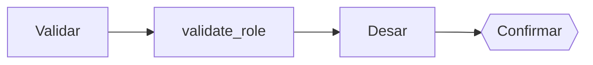

# authz_roles

`resource_engine.authz.resources.RoleResource` — entitat `Role`

Custom roles, created from the front end. System roles are defined in code.

## Àmbit de negoci

Permissions

## Operacions

| Operació | Tipus | Endpoint | Entrada | Sortida | Descripció |
|---|---|---|---|---|---|
| `list` | crud | `GET /authz_roles` |  | RoleRead | Lists the custom roles. |
| `get` | crud | `GET /authz_roles/{id}` |  | RoleRead | Returns a custom role. |
| `create` | crud | `POST /authz_roles` | RoleCreate | RoleRead | Creates a custom role. |
| `update` | crud | `PATCH /authz_roles/{id}` | RoleUpdate | RoleRead | Changes a custom role's description. |
| `delete` | crud | `DELETE /authz_roles/{id}` |  |  | Deletes a custom role. |

Filtres: — · Ordenació: `name`

Auditoria: s'auditen els canvis i els intents denegats.

## Què passa en cada operació

Els passos **abans de confirmar** són dins la transacció: si un falla, el canvi es rebutja i no es desa res. Els passos **després de confirmar** s'executen amb el canvi ja desat: un error queda registrat, però no el desfà.

### Crear (`create`)

1. Es valida l'entrada (`RoleCreate`).
2. Abans de desar: `validate_role` — Custom roles cannot reuse system role names.
3. Es desa el registre nou.
4. Es confirma el canvi, amb l'auditoria i els esdeveniments.

| Punt | Hook | Efectes externs | Descripció |
|---|---|---|---|
| `before_create` | `validate_role` | no | Custom roles cannot reuse system role names. |

## Esquemes

### RoleCreate (create)

| Camp | Tipus | Obligatori | Descripció |
|---|---|---|---|
| `name` | `str` | sí | Role name |
| `description` | `str \| None` | no | What the role is for |

### RoleUpdate (update)

| Camp | Tipus | Obligatori | Descripció |
|---|---|---|---|
| `description` | `str \| None` | no | — |

### RoleRead (read)

| Camp | Tipus | Obligatori | Descripció |
|---|---|---|---|
| `name` | `str` | sí | Role name |
| `description` | `str \| None` | no | What the role is for |
| `created_at` | `datetime \| None` | no | Creation time |
