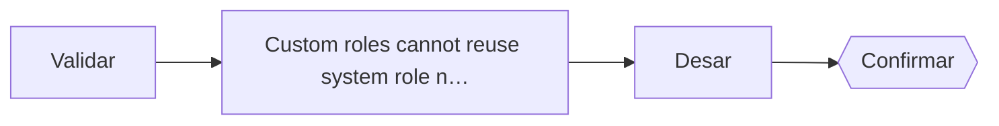

# authz_roles

Custom roles, created from the front end. System roles are defined in code.

## Àmbit de negoci

Permissions

## Operacions

| Operació | Tipus | Descripció |
|---|---|---|
| `list` | crud | Lists the custom roles. |
| `get` | crud | Returns a custom role. |
| `create` | crud | Creates a custom role. |
| `update` | crud | Changes a custom role's description. |
| `delete` | crud | Deletes a custom role. |

Auditoria: s'auditen els canvis i els intents denegats.

## Què passa en cada operació

Els passos **abans de confirmar** són dins la transacció: si un falla, el canvi es rebutja i no es desa res. Els passos **després de confirmar** s'executen amb el canvi ja desat: un error queda registrat, però no el desfà.

### Crear (`create`)

1. Es valida l'entrada.
2. Abans de desar: Custom roles cannot reuse system role names.
3. Es desa el registre nou.
4. Es confirma el canvi, amb l'auditoria i els esdeveniments.

