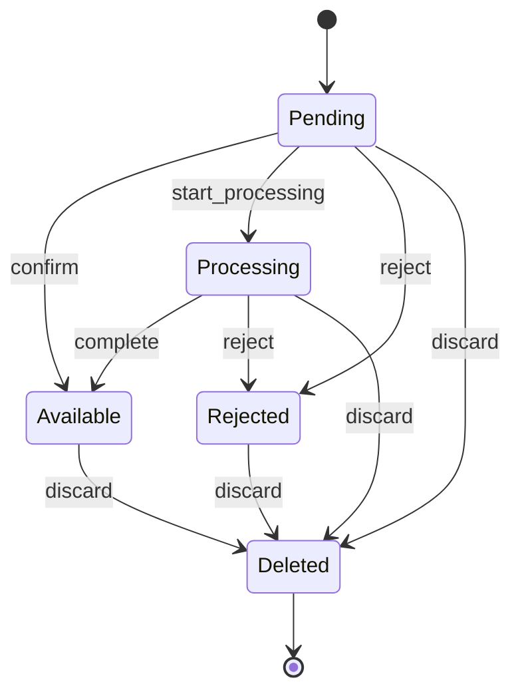

# documents

`resource_engine.documents.resource.DocumentResource` — entitat `Document`

Files attached to entities of other resources.

Business resources declare slots (``documents = [DocumentSlot(...)]``); the
engine stores each file's content in the blob store and its metadata here.
Documents are created, replaced and removed through the owner resource
(``attach`` / ``detach``), never directly.

## Business area

Documents

## Operacions

| Operació | Tipus | Endpoint | Entrada | Sortida | Descripció |
|---|---|---|---|---|---|
| `list` | crud | `GET /documents` |  | DocumentRead | Lists documents, filterable by owner, slot and status. |
| `get` | crud | `GET /documents/{id}` |  | DocumentRead | Returns a document's metadata. |
| `confirm` | transition | `POST /documents/{id}/transitions/confirm` |  | DocumentRead | The content is stored and needs no processing. |
| `start_processing` | transition | `POST /documents/{id}/transitions/start_processing` |  | DocumentRead | The content is stored and goes to the pipeline. |
| `reject` | transition | `POST /documents/{id}/transitions/reject` |  | DocumentRead | The pipeline or the upload check refused it. |
| `discard` | transition | `POST /documents/{id}/transitions/discard` |  | DocumentRead | The document is detached or its upload expired. |
| `complete` | transition | `POST /documents/{id}/transitions/complete` |  | DocumentRead | The pipeline accepted the document. |

Filtres: `owner_resource`, `owner_id`, `slot`, `status` · Ordenació: `created_at`, `filename`, `size`

Auditoria: s'auditen els canvis i els intents denegats.

## Màquina d'estats

`resource_engine.documents.machine.DocumentStateMachine` — camp `status`

Life of a document from upload to deletion.

| Estat | Nom | Descripció |
|---|---|---|
| `pending` (inicial) | Pending | Upload requested; the content is not confirmed yet. |
| `processing` | Processing | Stored and waiting for the processing pipeline. |
| `available` | Available | Stored, verified and processed; it can be downloaded. |
| `rejected` | Rejected | The pipeline refused it (see ``error``). |
| `deleted` (final) | Deleted | Detached; the content is purged from the store. |

| Transició | Origen | Destí | Descripció |
|---|---|---|---|
| `confirm` | `pending` | `available` | The content is stored and needs no processing. |
| `start_processing` | `pending` | `processing` | The content is stored and goes to the pipeline. |
| `reject` | `pending` | `rejected` | The pipeline or the upload check refused it. |
| `discard` | `pending` | `deleted` | The document is detached or its upload expired. |
| `complete` | `processing` | `available` | The pipeline accepted the document. |
| `reject` | `processing` | `rejected` | The pipeline or the upload check refused it. |
| `discard` | `processing` | `deleted` | The document is detached or its upload expired. |
| `discard` | `available` | `deleted` | The document is detached or its upload expired. |
| `discard` | `rejected` | `deleted` | The document is detached or its upload expired. |

## Schemas

### DocumentRead (read)

| Camp | Tipus | Obligatori | Descripció |
|---|---|---|---|
| `id` | `str` | sí | Document identifier |
| `owner_resource` | `str` | sí | Resource the document belongs to |
| `owner_id` | `str` | sí | Identifier of the owning entity |
| `slot` | `str` | sí | Slot of the owning resource |
| `status` | `str` | sí | pending, processing, available, rejected or deleted |
| `filename` | `str` | sí | Original file name (sanitised) |
| `content_type` | `str` | sí | MIME type |
| `size` | `int \| None` | no | Size in bytes |
| `sha256` | `str \| None` | no | SHA-256 of the content, hex |
| `created_at` | `datetime \| None` | no | When it was attached |
| `created_by` | `str \| None` | no | Actor that attached it |
| `metadata` | `dict[str, Any]` | no | Data from processing |
| `error` | `str \| None` | no | Why processing rejected it |
