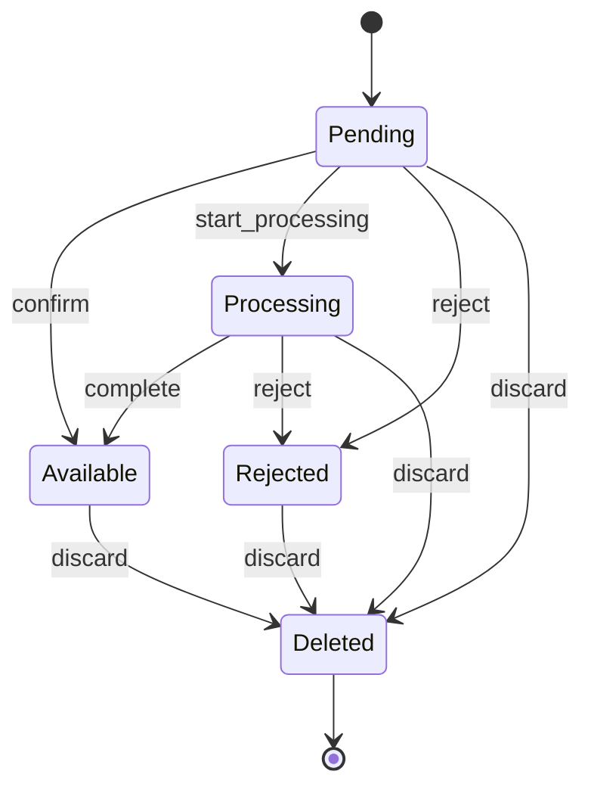

# documents

Files attached to entities of other resources.

Business resources declare slots (``documents = [DocumentSlot(...)]``); the
engine stores each file's content in the blob store and its metadata here.
Documents are created, replaced and removed through the owner resource
(``attach`` / ``detach``), never directly.

## Àmbit de negoci

Documents

## Operacions

| Operació | Tipus | Descripció |
|---|---|---|
| `list` | crud | Lists documents, filterable by owner, slot and status. |
| `get` | crud | Returns a document's metadata. |
| `confirm` | transition | The content is stored and needs no processing. |
| `start_processing` | transition | The content is stored and goes to the pipeline. |
| `reject` | transition | The pipeline or the upload check refused it. |
| `discard` | transition | The document is detached or its upload expired. |
| `complete` | transition | The pipeline accepted the document. |

Auditoria: s'auditen els canvis i els intents denegats.

## Màquina d'estats

Life of a document from upload to deletion.

| Estat | Nom | Descripció |
|---|---|---|
| `pending` (inicial) | Pending | Upload requested; the content is not confirmed yet. |
| `processing` | Processing | Stored and waiting for the processing pipeline. |
| `available` | Available | Stored, verified and processed; it can be downloaded. |
| `rejected` | Rejected | The pipeline refused it (see ``error``). |
| `deleted` (final) | Deleted | Detached; the content is purged from the store. |

| Transició | Origen | Destí | Descripció |
|---|---|---|---|
| `confirm` | `pending` | `available` | The content is stored and needs no processing. |
| `start_processing` | `pending` | `processing` | The content is stored and goes to the pipeline. |
| `reject` | `pending` | `rejected` | The pipeline or the upload check refused it. |
| `discard` | `pending` | `deleted` | The document is detached or its upload expired. |
| `complete` | `processing` | `available` | The pipeline accepted the document. |
| `reject` | `processing` | `rejected` | The pipeline or the upload check refused it. |
| `discard` | `processing` | `deleted` | The document is detached or its upload expired. |
| `discard` | `available` | `deleted` | The document is detached or its upload expired. |
| `discard` | `rejected` | `deleted` | The document is detached or its upload expired. |
