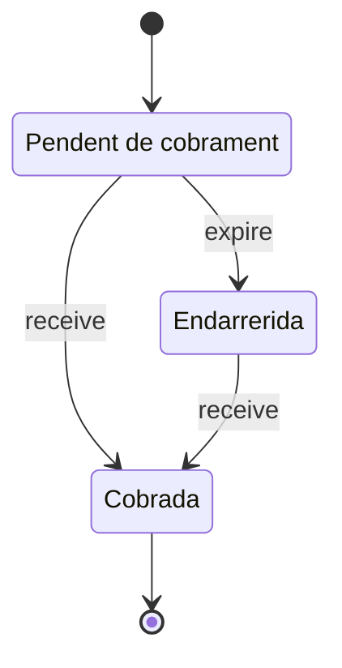

# invoice_payments

`invoices.application.processes.InvoicePaymentProcess` — entitat `InvoicePayment`

Cobrament de les factures aprovades.

Comença quan s'aprova una factura, espera l'esdeveniment ``PaymentReceived``
del servei de pagaments i aleshores marca la factura com a cobrada. Si en 15
dies no arriba, passa a endarrerida i ho anuncia; un cobrament posterior el
tanca igualment.

## Business area

Facturació

## Actors

- Servei de pagaments

## Operacions

| Operació | Tipus | Endpoint | Entrada | Sortida | Descripció |
|---|---|---|---|---|---|
| `list` | crud | `GET /invoice_payments` |  | PaymentRead | Llista els cobraments en curs i acabats. |
| `get` | crud | `GET /invoice_payments/{id}` |  | PaymentRead | Consulta el cobrament d'una factura. |
| `create` | crud | `POST /invoice_payments` | PaymentStart | PaymentRead | El crea el procés quan s'aprova una factura. |
| `receive` | transition | `POST /invoice_payments/{id}/transitions/receive` |  | PaymentRead | El servei de pagaments ha cobrat la factura. |
| `expire` | transition | `POST /invoice_payments/{id}/transitions/expire` |  | PaymentRead | Han passat 15 dies sense cobrament. |

Filtres: `status`, `invoice_id` · Ordenació: `id`

Multi-inquilí: cada registre pertany a l'inquilí del camp `organization`; les operacions es limiten a l'inquilí de qui crida.

Auditoria: s'auditen els canvis i els intents denegats.

## Màquina d'estats

`invoices.domain.state_machine.PaymentFlow` — camp `status`

Cobrament d'una factura aprovada.

| Estat | Nom | Descripció |
|---|---|---|
| `awaiting` (inicial) | Pendent de cobrament | S'espera el cobrament del servei de pagaments. |
| `overdue` | Endarrerida | Han passat 15 dies sense cobrament; encara es pot cobrar. |
| `settled` (final) | Cobrada | Cobrada. Estat final. |

| Transició | Origen | Destí | Descripció |
|---|---|---|---|
| `receive` | `awaiting` | `settled` | El servei de pagaments ha cobrat la factura. |
| `expire` | `awaiting` | `overdue` | Han passat 15 dies sense cobrament. |
| `receive` | `overdue` | `settled` | El servei de pagaments ha cobrat la factura. |

### Transicions automàtiques

| Transició | Després de | Des de | Comptat des de | Descripció |
|---|---|---|---|---|
| `expire` | 15d | `awaiting` | `status_changed_at` | Sense cobrament en 15 dies, el cobrament queda endarrerit. |

Les executa el treballador (`TimerJob`) com a principal del sistema; queden a l'historial i a l'auditoria com qualsevol transició.

## Procés

Cada registre és una instància del procés, una per valor de `invoice_id`. Reacciona a aquests esdeveniments:

| Esdeveniment | Quan | Clau | Inicia | Què fa |
|---|---|---|---|---|
| `TransitionExecuted` | resource invoices, transition approve | `entity_id` | sí | Quan s'aprova una factura, comença a esperar-ne el cobrament. |
| `PaymentReceived` | — | `invoice_id` | no | Un cobrament del servei de pagaments tanca el procés i marca la factura com a cobrada. |

## Referències

| Relació | Camp | Recurs | En eliminar-lo | Descripció |
|---|---|---|---|---|
| `invoice` | `invoice_id` | [invoices](invoices.md) | es denega mentre hi hagi referències | — |

Amb `expand` (`?expand=` per HTTP) la resposta inclou el registre relacionat; els filtres `<relació>.<camp>` filtren pels camps filtrables del recurs relacionat.

## Esdeveniments de domini

### `PaymentOverdue`

`invoices.domain.events.PaymentOverdue`

Una factura aprovada fa 15 dies que espera el cobrament.

| Camp | Tipus | Obligatori |
|---|---|---|
| `invoice_id` | `int` | sí |

## Hooks del cicle de vida

| Punt | Hook | Efectes externs | Descripció |
|---|---|---|---|
| `after_transition:expire` | `announce_overdue` | no | Emet ``PaymentOverdue`` perquè altres serveis (recordatoris) en tinguin notícia. |

## Schemas

### PaymentStart (create)

| Camp | Tipus | Obligatori | Descripció |
|---|---|---|---|
| `invoice_id` | `int` | sí | Factura aprovada |
| `amount` | `Decimal` | sí | Import a cobrar |

### PaymentRead (read)

| Camp | Tipus | Obligatori | Descripció |
|---|---|---|---|
| `invoice_id` | `int` | sí | Factura aprovada |
| `amount` | `Decimal` | sí | Import a cobrar |
| `id` | `int` | sí | — |
| `status` | `str` | sí | awaiting, overdue o settled |
| `status_changed_at` | `datetime \| None` | no | Últim canvi d'estat |
| `organization` | `str \| None` | no | Organització propietària (tenant); la posa el motor a partir del token |
