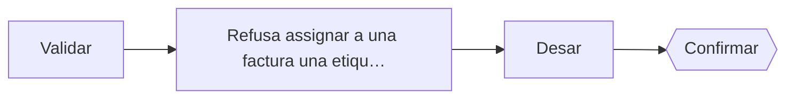

# invoice_tags

Etiquetes assignades a factures (molts a molts).

Les factures tenen la relació ``tags`` i les etiquetes la relació
``invoices``; assignar i treure etiquetes és crear i eliminar aquests
registres.

## Àmbit de negoci

Facturació

## Actors

- Emissor de factures

## Operacions

| Operació | Tipus | Descripció |
|---|---|---|
| `list` | crud | Llista les assignacions d'etiquetes. |
| `get` | crud | Consulta una assignació. |
| `create` | crud | Assigna una etiqueta a una factura. |
| `delete` | crud | Treu una etiqueta d'una factura. |

Multi-inquilí: cada registre pertany a l'inquilí del camp `organization`; les operacions es limiten a l'inquilí de qui crida.

Auditoria: s'auditen els canvis i els intents denegats.

## Referències

| Relació | Camp | Recurs | En eliminar-lo | Descripció |
|---|---|---|---|---|
| `invoice` | `invoice_id` | [invoices](invoices.md) | s'eliminen en cascada | — |
| `tag` | `tag_id` | [tags](tags.md) | s'eliminen en cascada | — |

## Què passa en cada operació

Els passos **abans de confirmar** són dins la transacció: si un falla, el canvi es rebutja i no es desa res. Els passos **després de confirmar** s'executen amb el canvi ja desat: un error queda registrat, però no el desfà.

### Crear (`create`)

1. Es valida l'entrada.
2. Abans de desar: Refusa assignar a una factura una etiqueta que ja té.
3. Es desa el registre nou.
4. Es confirma el canvi, amb l'auditoria i els esdeveniments.

