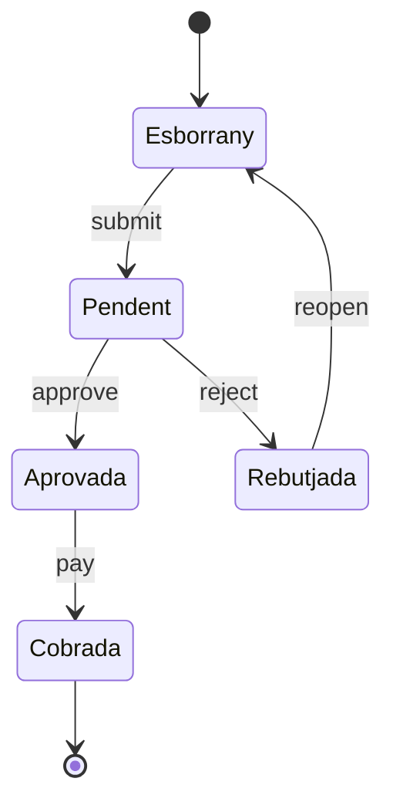

# invoices

`invoices.application.resource.InvoiceResource` — entitat `Invoice`

Gestió de factures de l'organització.

Permet crear, consultar i modificar factures, així com gestionar-ne el
procés d'aprovació i cobrament.

## Business area

Facturació

## Actors

- Administrador
- Comptable
- Responsable

## Operacions

| Operació | Tipus | Endpoint | Entrada | Sortida | Descripció |
|---|---|---|---|---|---|
| `list` | crud | `GET /invoices` |  | InvoiceRead | Llista les factures, filtrables per estat i client. |
| `get` | crud | `GET /invoices/{id}` |  | InvoiceRead | Consulta una factura. |
| `create` | crud | `POST /invoices` | InvoiceCreate | InvoiceRead | Crea una factura en estat esborrany. |
| `update` | crud | `PATCH /invoices/{id}` | InvoiceUpdate | InvoiceRead | Modifica una factura mentre és un esborrany. |
| `delete` | crud | `DELETE /invoices/{id}` |  |  | Elimina una factura en esborrany. |
| `submit` | transition | `POST /invoices/{id}/transitions/submit` |  | InvoiceRead | Envia l'esborrany a aprovació. |
| `approve` | transition | `POST /invoices/{id}/transitions/approve` |  | InvoiceRead | Aprova una factura pendent. |
| `reject` | transition | `POST /invoices/{id}/transitions/reject` | RejectInvoice | InvoiceRead | Rebutja una factura pendent indicant-ne el motiu. |
| `pay` | transition | `POST /invoices/{id}/transitions/pay` |  | InvoiceRead | Registra el cobrament d'una factura aprovada. |
| `reopen` | transition | `POST /invoices/{id}/transitions/reopen` |  | InvoiceRead | Torna una factura rebutjada a esborrany. |
| `recalculate_totals` | action | `POST /invoices/{id}/actions/recalculate_totals` | ApplyDiscount |  | Aplica un descompte percentual a l'import d'una factura. |
| `render_summary` | action | `POST /invoices/{id}/actions/render_summary` |  |  | Genera un resum en Markdown de la factura i l'adjunta a la ranura ``summary``. |

Filtres: `status`, `customer` · Ordenació: `id`, `amount`, `issue_date`

## Màquina d'estats

`invoices.domain.state_machine.InvoiceStateMachine` — camp `status`

Procés d'aprovació i cobrament d'una factura.

| Estat | Nom | Descripció |
|---|---|---|
| `draft` (inicial) | Esborrany | Esborrany editable per l'emissor. |
| `pending` | Pendent | Enviada a aprovació; ja no es pot modificar. |
| `approved` | Aprovada | Aprovada i pendent de cobrament. |
| `rejected` | Rebutjada | Rebutjada pel responsable. |
| `paid` (final) | Cobrada | Cobrada. Estat final. |

| Transició | Origen | Destí | Descripció |
|---|---|---|---|
| `submit` | `draft` | `pending` | Envia l'esborrany a aprovació. |
| `approve` | `pending` | `approved` | Aprova una factura pendent. |
| `reject` | `pending` | `rejected` | Rebutja una factura pendent indicant-ne el motiu. |
| `pay` | `approved` | `paid` | Registra el cobrament d'una factura aprovada. |
| `reopen` | `rejected` | `draft` | Torna una factura rebutjada a esborrany. |

## Accions

### `recalculate_totals`

`invoices.application.actions.RecalculateTotals`

Aplica un descompte percentual a l'import d'una factura.

#### Preconditions

La factura és un esborrany.

#### Postconditions

L'import queda reduït pel percentatge indicat, arrodonit a cèntims.

#### Effects

Emet l'esdeveniment ``InvoiceTotalsRecalculated``.

### `render_summary`

`invoices.application.actions.RenderSummary`

Genera un resum en Markdown de la factura i l'adjunta a la ranura ``summary``.

#### Postconditions

La factura té un únic document ``summary`` amb les dades actuals.

#### Effects

Desa el document al magatzem de fitxers i emet ``DocumentAttached``.

## Documents

| Ranura | Tipus | Mida màx. | Múltiple | Pujada | Requerit per | Processament | Descripció |
|---|---|---|---|---|---|---|---|
| `signed_pdf` | application/pdf | 10485760 B | no | any | `approve` | no | Factura signada pel client; cal per aprovar-la. |
| `attachments` | */* | 26214400 B | sí | any | — | no | Justificants i altra documentació de suport. |
| `summary` | text/markdown | 26214400 B | no | api | — | no | Resum generat per l'acció render_summary. |

## Hooks del cicle de vida

| Punt | Hook | Efectes externs | Descripció |
|---|---|---|---|
| `before_create` | `validate_amount` | no | Rebutja factures amb import negatiu. |
| `before_update` | `ensure_editable` | no | Només es poden modificar o eliminar factures en esborrany. |
| `after_update` | `validate_amount` | no | Rebutja factures amb import negatiu. |
| `before_delete` | `ensure_editable` | no | Només es poden modificar o eliminar factures en esborrany. |
| `after_commit` | `notify_approval` | sí | Notifica el client que la factura ha estat aprovada. |

## Schemas

### InvoiceCreate (create)

| Camp | Tipus | Obligatori | Descripció |
|---|---|---|---|
| `customer` | `str` | sí | Nom del client |
| `amount` | `Decimal` | sí | Import total |
| `issue_date` | `datetime.date \| None` | no | Data d'emissió |
| `notes` | `str \| None` | no | — |

### InvoiceUpdate (update)

| Camp | Tipus | Obligatori | Descripció |
|---|---|---|---|
| `customer` | `str \| None` | no | — |
| `amount` | `decimal.Decimal \| None` | no | — |
| `issue_date` | `datetime.date \| None` | no | — |
| `notes` | `str \| None` | no | — |

### InvoiceRead (read)

| Camp | Tipus | Obligatori | Descripció |
|---|---|---|---|
| `id` | `int` | sí | — |
| `customer` | `str` | sí | — |
| `amount` | `Decimal` | sí | — |
| `issue_date` | `datetime.date \| None` | sí | — |
| `notes` | `str \| None` | sí | — |
| `status` | `str` | sí | — |
| `rejection_reason` | `str \| None` | sí | — |
