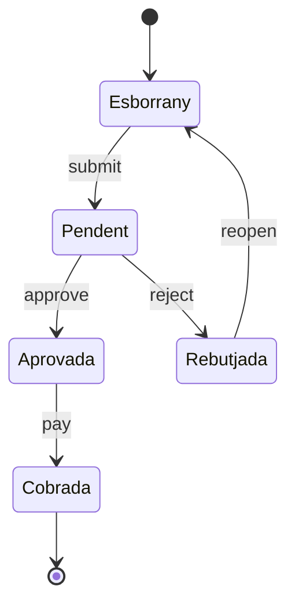
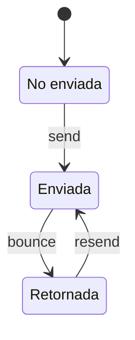
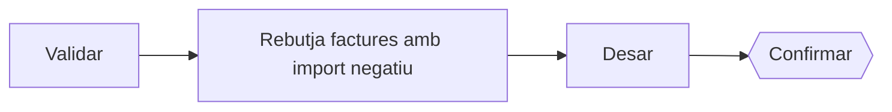
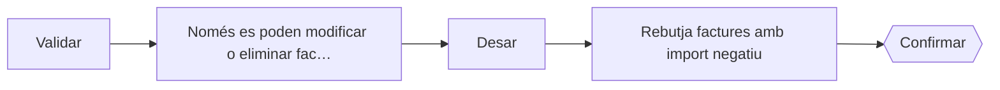
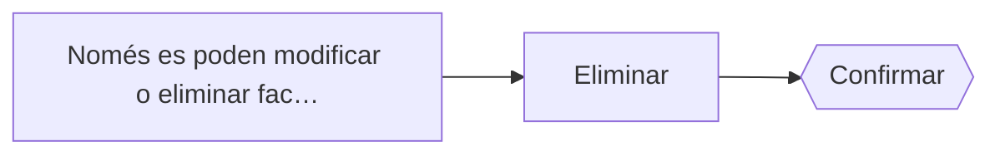
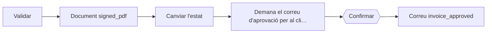

# invoices

Gestió de factures de l'organització.

Permet crear, consultar i modificar factures, així com gestionar-ne el
procés d'aprovació i cobrament.

## Àmbit de negoci

Facturació

## Actors

- Administrador
- Comptable
- Responsable

## Operacions

| Operació | Tipus | Descripció |
|---|---|---|
| `list` | crud | Llista les factures, filtrables per estat i client. |
| `get` | crud | Consulta una factura. |
| `create` | crud | Crea una factura en estat esborrany. |
| `update` | crud | Modifica una factura mentre és un esborrany. |
| `delete` | crud | Elimina una factura en esborrany. |
| `submit` | transition | Envia l'esborrany a aprovació. |
| `approve` | transition | Aprova una factura pendent. |
| `reject` | transition | Rebutja una factura pendent indicant-ne el motiu. |
| `pay` | transition | Registra el cobrament d'una factura aprovada. |
| `reopen` | transition | Torna una factura rebutjada a esborrany. |
| `send` | transition | Envia al client una factura aprovada o cobrada. |
| `bounce` | transition | El correu d'enviament ha rebotat. |
| `resend` | transition | Torna a enviar una factura retornada. |
| `recalculate_totals` | action | Aplica un descompte percentual a l'import d'una factura. |
| `render_summary` | action | Genera un resum en Markdown de la factura i l'adjunta a la ranura ``summary``. |

Multi-inquilí: cada registre pertany a l'inquilí del camp `organization`; les operacions es limiten a l'inquilí de qui crida.

Camps restringits: `notes` — només els veuen o modifiquen els rols amb una concessió explícita.

Auditoria: s'auditen els canvis i els intents denegats; sense valors per a `notes`.

## Màquina d'estats `approval`

Procés d'aprovació i cobrament d'una factura.

| Estat | Nom | Descripció |
|---|---|---|
| `draft` (inicial) | Esborrany | Esborrany editable per l'emissor. |
| `pending` | Pendent | Enviada a aprovació; ja no es pot modificar. |
| `approved` | Aprovada | Aprovada i pendent de cobrament. |
| `rejected` | Rebutjada | Rebutjada pel responsable. |
| `paid` (final) | Cobrada | Cobrada. Estat final. |

| Transició | Origen | Destí | Descripció |
|---|---|---|---|
| `submit` | `draft` | `pending` | Envia l'esborrany a aprovació. |
| `approve` | `pending` | `approved` | Aprova una factura pendent. |
| `reject` | `pending` | `rejected` | Rebutja una factura pendent indicant-ne el motiu. |
| `pay` | `approved` | `paid` | Registra el cobrament d'una factura aprovada. |
| `reopen` | `rejected` | `draft` | Torna una factura rebutjada a esborrany. |

## Màquina d'estats `delivery`

Enviament d'una factura al client, independent de la seva aprovació.

| Estat | Nom | Descripció |
|---|---|---|
| `unsent` (inicial) | No enviada | Encara no s'ha enviat al client. |
| `sent` | Enviada | Enviada al client. |
| `returned` | Retornada | El correu ha rebotat; cal tornar-la a enviar. |

| Transició | Origen | Destí | Descripció |
|---|---|---|---|
| `send` | `unsent` | `sent` | Envia al client una factura aprovada o cobrada. |
| `bounce` | `sent` | `returned` | El correu d'enviament ha rebotat. |
| `resend` | `returned` | `sent` | Torna a enviar una factura retornada. |

### Transicions automàtiques

| Transició | Després de | Origen | Comptat des de | Descripció |
|---|---|---|---|---|
| `reject` | 30d | `pending` | `status_changed_at` | Les factures pendents d'aprovar més de 30 dies es rebutgen soles. |

Les executa el treballador (`TimerJob`) com a principal del sistema; queden a l'historial i a l'auditoria com qualsevol transició.

## Accions

### `recalculate_totals`

Aplica un descompte percentual a l'import d'una factura.

#### Precondicions

La factura és un esborrany.

#### Postcondicions

L'import queda reduït pel percentatge indicat, arrodonit a cèntims.

#### Efectes

Emet l'esdeveniment ``InvoiceTotalsRecalculated``.

### `render_summary`

Genera un resum en Markdown de la factura i l'adjunta a la ranura ``summary``.

#### Postcondicions

La factura té un únic document ``summary`` amb les dades actuals.

#### Efectes

Desa el document al magatzem de fitxers i emet ``DocumentAttached``.

## Referències

| Relació | Camp | Recurs | En eliminar-lo | Descripció |
|---|---|---|---|---|
| `customer_record` | `customer_id` | [customers](customers.md) | es denega mentre hi hagi referències | Client registrat al qual s'emet la factura. |

Hi fan referència: [invoice_tags.invoice_id](invoice_tags.md) (s'eliminen en cascada), [invoice_payments.invoice_id](invoice_payments.md) (es denega mentre hi hagi referències).

## Relacions molts a molts

| Relació | Registres | A través de |
|---|---|---|
| `tags` | [tags](tags.md) | [invoice_tags](invoice_tags.md) |

S'enllacen i es desenllacen creant i eliminant registres del recurs intermedi; `expand` també accepta aquestes relacions.

## Esdeveniments de domini

### `InvoiceTotalsRecalculated`

L'import d'una factura s'ha recalculat aplicant un descompte.

| Camp | Tipus | Obligatori |
|---|---|---|
| `invoice_id` | `int` | sí |
| `previous_amount` | `Decimal` | sí |
| `new_amount` | `Decimal` | sí |

## Documents

| Ranura | Tipus | Mida màx. | Múltiple | Pujada | Requerit per | Processament | Descripció |
|---|---|---|---|---|---|---|---|
| `signed_pdf` | application/pdf | 10485760 B | no | any | `approve` | no | Factura signada pel client; cal per aprovar-la. |
| `attachments` | */* | 26214400 B | sí | any | — | no | Justificants i altra documentació de suport. |
| `summary` | text/markdown | 26214400 B | no | api | — | no | Resum generat per l'acció render_summary. |

## Correus

| Correu | Quan | Destinataris | Idioma |
|---|---|---|---|
| [`invoice_approved`](../emails.md#invoice_approved) | en la transició `approve` | `[customer.email]` | ca |

Es demanen dins la transacció i s'envien quan el canvi s'ha confirmat; si el canvi es desfà, no s'envien.

## Què passa en cada operació

Els passos **abans de confirmar** són dins la transacció: si un falla, el canvi es rebutja i no es desa res. Els passos **després de confirmar** s'executen amb el canvi ja desat: un error queda registrat, però no el desfà.

### Crear (`create`)

1. Es valida l'entrada.
2. Abans de desar: Rebutja factures amb import negatiu.
3. Es desa el registre nou.
4. Es confirma el canvi, amb l'auditoria i els esdeveniments.

### Modificar (`update`)

1. Es valida l'entrada.
2. Abans de desar: Només es poden modificar o eliminar factures en esborrany.
3. Es desen els canvis.
4. Abans de confirmar: Rebutja factures amb import negatiu.
5. Es confirma el canvi, amb l'auditoria i els esdeveniments.

### Eliminar (`delete`)

1. Abans de desar: Només es poden modificar o eliminar factures en esborrany.
2. S'elimina el registre.
3. Es confirma el canvi, amb l'auditoria i els esdeveniments.

### Transició `approve`

1. Es valida l'entrada.
2. Cal un document disponible a `signed_pdf`.
3. Canvia l'estat.
4. Abans de confirmar: Demana el correu d'aprovació per al client registrat, si té adreça.
5. Es confirma el canvi, amb l'auditoria i els esdeveniments.
6. Després de confirmar: s'envia el correu [`invoice_approved`](../emails.md#invoice_approved) a `[customer.email]`.

Després de qualsevol canvi confirmat d'aquest recurs:

- Notifica el client que la factura ha estat aprovada. (efecte extern)
