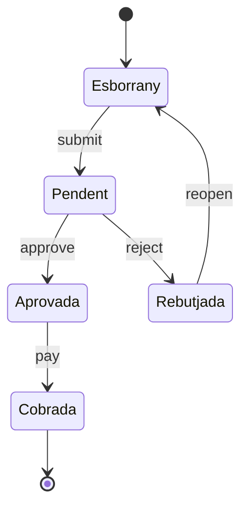
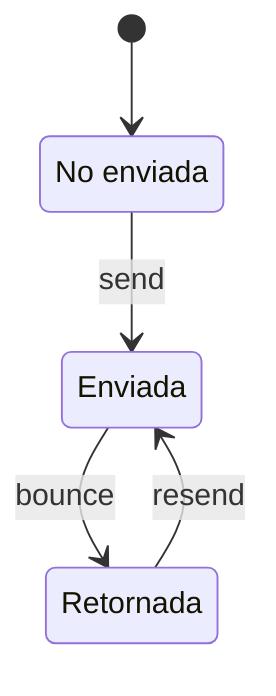
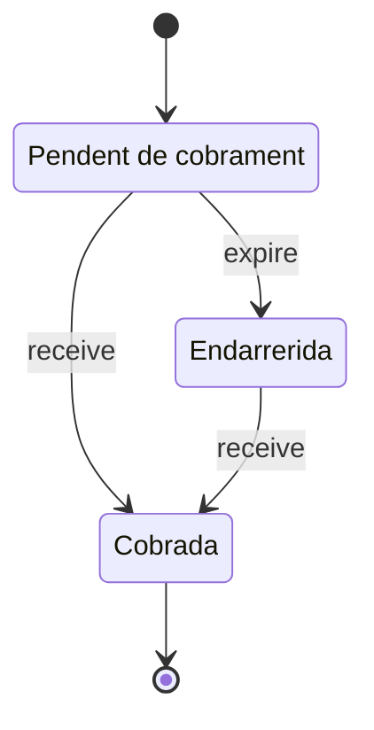
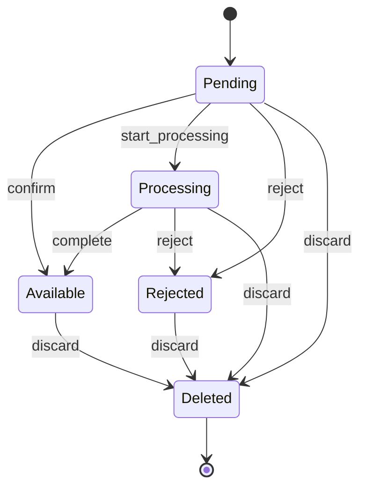
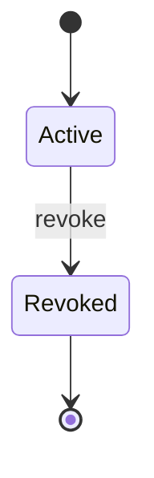

# Màquines d'estats

Els processos amb estats de cada recurs, dibuixats a partir de la definició executable de la màquina. Els detalls de cada estat i transició són a la pàgina del recurs.

## invoices: approval

Recurs [invoices](resources/invoices.md) — camp `status` — `invoices.domain.state_machine.InvoiceStateMachine`

Procés d'aprovació i cobrament d'una factura.

Transicions automàtiques: `reject` després de 30d.

## invoices: delivery

Recurs [invoices](resources/invoices.md) — camp `delivery_status` — `invoices.domain.state_machine.InvoiceDelivery`

Enviament d'una factura al client, independent de la seva aprovació.

## invoice_payments: status

Recurs [invoice_payments](resources/invoice_payments.md) — camp `status` — `invoices.domain.state_machine.PaymentFlow`

Cobrament d'una factura aprovada.

Transicions automàtiques: `expire` després de 15d.

## documents: status

Recurs [documents](resources/documents.md) — camp `status` — `resource_engine.documents.machine.DocumentStateMachine`

Life of a document from upload to deletion.

## authz_api_keys: status

Recurs [authz_api_keys](resources/authz_api_keys.md) — camp `status` — `resource_engine.authz.apikeys.ApiKeyStates`

Lifecycle of an API key.

